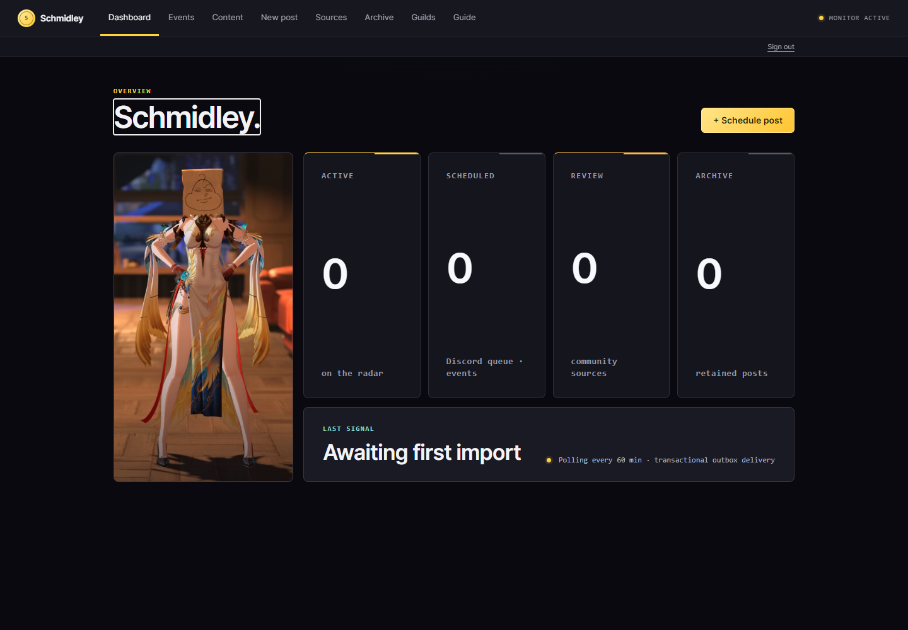
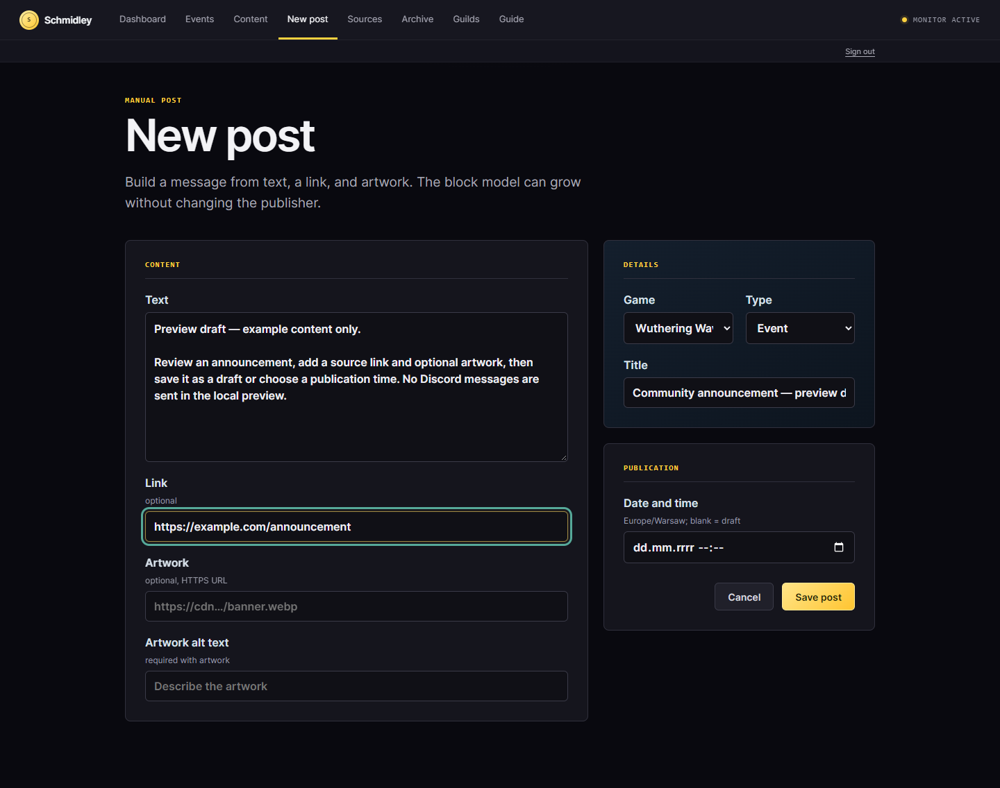
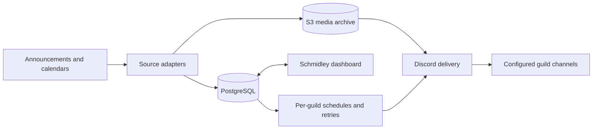

<p align="center">
  
</p>

<h1 align="center">Gachabot</h1>

<p align="center">
  <strong>Game announcements and event reminders for your Discord communities.</strong><br>
  A self-hosted bot and web dashboard for Wuthering Waves and Neverness to Everness.
</p>

<p align="center">
  
  
  
  <a href="LICENSE"></a>
</p>

<p align="center">
  <a href="#preview-the-dashboard">Try locally</a> ·
  <a href="#run-your-own-bot">Run your bot</a> ·
  <a href="#how-it-works">Architecture</a> ·
  <a href="#documentation">Documentation</a>
</p>

Gachabot collects announcements and event calendars into one operational view, then publishes updates independently to each Discord guild. Choose which games and subjects a server follows, where updates appear, and when event reminders should arrive.

The dashboard is called **Schmidley** in the application. It shows imported content, source health, upcoming events, pending publications and delivery history.



*Actual local dashboard with an empty database. Source workers and Discord delivery are disabled in preview mode.*

## What it handles

| Capability | Behavior |
| --- | --- |
| Game feeds | Import configured announcements and event calendars for Wuthering Waves and Neverness to Everness. |
| Per-server subscriptions | Choose games, subjects and a destination channel separately for each guild. |
| Event reminders | Schedule start and end reminders, with configurable offsets from 0 to 72 hours. |
| Publication reliability | Deduplicate updates, retain source revisions and retry failed deliveries independently per guild. |
| Editorial control | Inspect imported blocks, review content and prepare manual posts in the dashboard. |
| Media archive | Store artwork in an S3-compatible bucket and send event images as Discord attachments. |

<details>
<summary>Post editor</summary>



*Compose text, a source link and optional artwork. Leave the publication time blank to save a draft. The screenshot uses example text, not a live game announcement.*

</details>

## Preview the dashboard

**Requires Docker with Compose.** This isolated configuration includes PostgreSQL and S3-compatible storage. No `.env`, Discord account, bot token, OAuth setup or TLS certificate is needed.

```sh
git clone https://github.com/ShiroTsuma/Gachabot.git
cd Gachabot
docker compose -f compose.preview.yaml up --build -d
```

Open **http://localhost:18791**. The first build downloads the .NET and Playwright images and can take several minutes. Follow startup with:

```sh
docker compose -f compose.preview.yaml logs -f dashboard
```

The preview starts with an empty database. Browse the dashboard and create a manual draft to explore the editor. Automatic source polling and Discord delivery are disabled; no messages are sent to a guild. It is a local dashboard preview, not a fully configured live bot.

The dashboard is bound to loopback only. The preview uses development access and fixed local credentials; do not expose it publicly or reuse those credentials for a live deployment.

Stop it with `docker compose -f compose.preview.yaml down`. Named volumes retain your local preview data between runs.

## Run your own bot

The production deployment uses your Discord application, PostgreSQL database and S3-compatible bucket. The included Compose stack runs Gachabot behind Caddy for HTTPS.

1. Create a Discord application with a bot and OAuth credentials.
2. Provision PostgreSQL and an S3-compatible bucket, then copy `.env.example` to `.env` and fill in their connection details.
3. Set the hostname and TLS configuration in `Caddyfile`, and register the matching Discord OAuth redirect URL.
4. Start with `docker compose up --build -d`.
5. Run `/gachabot-configure` in your guild, select its games and subjects, then enable publishing.

Follow the **[installation guide](docs/installation.md)** for exact settings, required Discord permissions, LAN certificates and public-domain deployment. PostgreSQL and S3 are external in the production Compose file; the preview file provisions separate local services for evaluation.

## How it works



Source definitions describe addresses, parsers and field rules. Ingestion retains revisions and publication state in PostgreSQL. Guild configuration determines which subjects become scheduled deliveries; separate retry state prevents a failed server from blocking the others.

The first scan of official announcement sources establishes a baseline instead of posting the entire backlog. Event timelines can schedule active or upcoming events according to each guild's configuration.

## Configure a guild

Run these slash commands in each guild. They are intentionally restricted to members with **Manage Server**.

```text
/gachabot-configure channel:#updates wuthering-waves:true neverness-to-everness:true delete-obsolete-posts:true
/gachabot-event-schedule start-before-hours:0 end-before-hours:48
/gachabot-subjects game:Wuthering Waves
/gachabot-subjects game:Neverness to Everness
/gachabot-enable
/gachabot-status
```

`start-before-hours` and `end-before-hours` accept `-1` to disable that type of event post, or values from `0` to `72`, including fractions such as `0.5`. The defaults publish an event at its start and send an end reminder 48 hours before it finishes. Use `/gachabot-disable` to pause a guild or `/gachabot-enable` to resume it.

`delete-obsolete-posts:true` is a per-guild setting on `/gachabot-configure`. It removes only messages posted by GachaBot after their source content expires or is archived; messages from people and other bots are never touched. Omit the option during later configuration changes to keep the existing setting.

`/gachabot-subjects` opens a private interactive selector for one game. Toggle the subjects you want (events, codes, news, updates, maintenance, characters, and announcements), then press **Save subjects**. Subject choices are stored separately for each game and affect both future posts and pending event reminders.

`/gachabot-configure` saves a new guild in the paused state, so you can choose the channel, games, schedule, and subjects before anything is posted. `/gachabot-enable` starts publications and queues currently active events that have not already been published for that guild. Reconfiguring a guild that is already enabled leaves it enabled. Each guild has separate delivery and retry state, so a failure on one server cannot block another.

## Documentation

| Guide | Contents |
| --- | --- |
| [Installation](docs/installation.md) | Production configuration, TLS, Discord application and first connection |
| [User guide](docs/user-guide.md) | Dashboard navigation and guild workflows |
| [Architecture](docs/architecture.md) | Components, persistence and publication flow |
| [Operations](docs/operations.md) | Deployment, maintenance and recovery |
| [Sources](docs/sources.md) | Source registry, parsing and operational configuration |
| [Development](docs/development.md) | Source build, tests and local execution |

## Feedback

Report bugs through [GitHub Issues](https://github.com/ShiroTsuma/Gachabot/issues). Include the commit, deployment method, affected source or guild workflow, reproduction steps and sanitized logs. Never include bot tokens, OAuth secrets or database credentials.

## License and attribution

Gachabot is [source-available](LICENSE). Individuals may run an unmodified instance for personal, non-commercial use. Redistribution, commercial use and distribution of modified versions require written permission from ShiroTsuma.

This is an independent project, not affiliated with Discord, Kuro Games, Hotta Studio, Game8 or WuWa Tracker. Source content and game artwork belong to their respective owners. Review source terms before enabling an integration.
