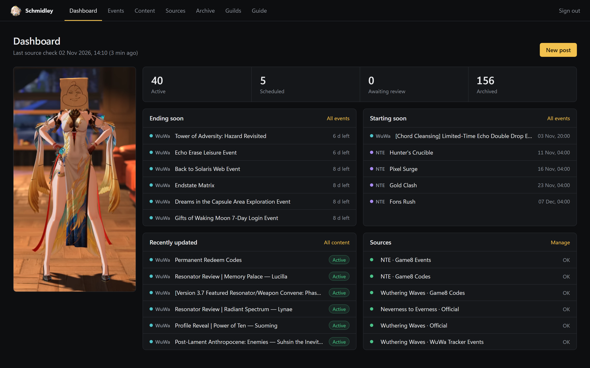
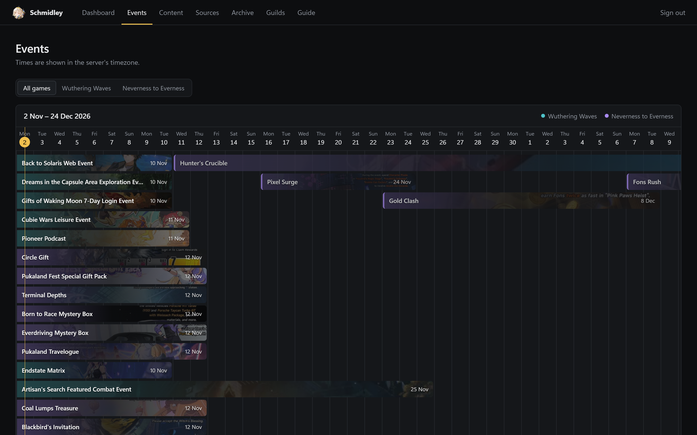
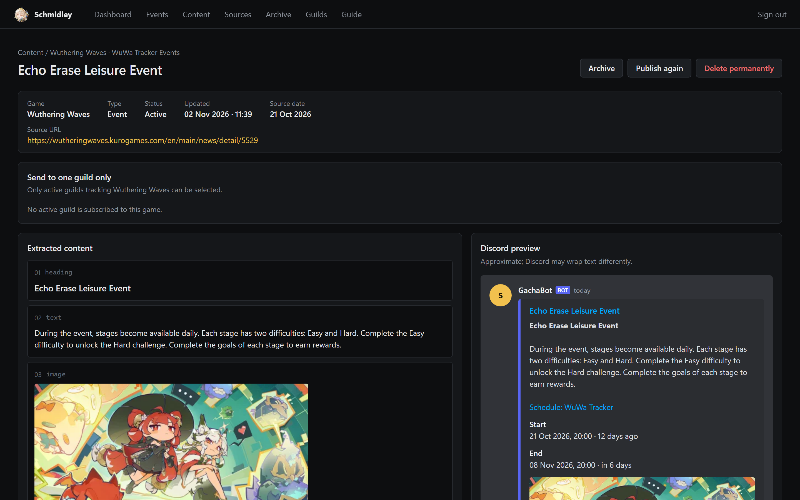
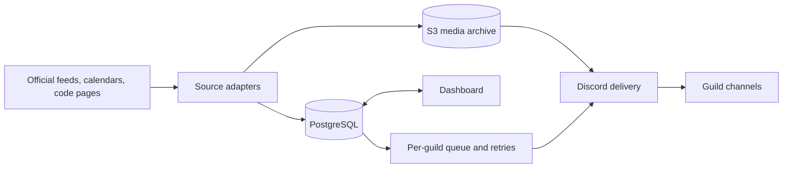

<p align="center">
  
</p>

<h1 align="center">Gachabot</h1>

<p align="center">
  <strong>Never miss a banner, event or redeem code.</strong><br>
  A self-hosted Discord bot and dashboard for Wuthering Waves and Neverness to Everness.
</p>

<p align="center">
  <a href="https://github.com/ShiroTsuma/Gachabot/actions/workflows/ci.yml"></a>
  
  
  <a href="LICENSE"></a>
</p>

<p align="center">
  <a href="#try-it-locally"><strong>Try it locally</strong></a> ·
  <a href="#run-your-own-bot">Run your bot</a> ·
  <a href="#configure-a-guild">Configure a guild</a> ·
  <a href="#one-event-two-servers">Example</a> ·
  <a href="#how-delivery-works">How delivery works</a> ·
  <a href="docs/README.md">Documentation</a>
</p>



*The dashboard of a running instance, with live data from the official sites, WuWa Tracker and Game8.*

Gachabot watches the official news feeds and community event calendars, keeps one archive of everything it finds, and posts to each Discord server on that server's terms: which games, which subjects, which channel, and when event reminders arrive. The dashboard shows what was imported, what is about to be posted, and where every post went.

| Follow | Gachabot handles |
| --- | --- |
| News and patch notes | Official Wuthering Waves and Neverness to Everness announcements, with images archived to your own S3 bucket |
| Events and banners | Calendars from WuWa Tracker and Game8, with a start post and an "ending soon" reminder at times each server picks |
| Redeem codes | Current and permanent code lists with rewards and expiry; a changed list is posted again so members notice it |
| Several servers | Separate channel, games, subjects, reminder offsets and retry state for every guild |
| Editorial control | A preview of the exact Discord messages, manual posts, approvals, archive and per-guild resends |

## Try it locally

**Requires Docker with Compose.** The preview bundles PostgreSQL and S3-compatible storage. It needs no Discord application, token, `.env` file or certificate, and it never posts to Discord.

```sh
git clone https://github.com/ShiroTsuma/Gachabot.git
cd Gachabot
docker compose -f compose.preview.yaml up --build -d
```

1. Open **http://localhost:18791**. The first build downloads the .NET and Playwright images and takes a few minutes.
2. The preview starts empty. Open **Sources** and click **Refresh all** to import live data. The first import archives artwork, so the official feeds take a few minutes; the event calendars and code pages finish in seconds.
3. Browse **Events**, open any post to see its Discord preview, or write a draft in **New post**.

> [!NOTE]
> The preview binds to `127.0.0.1` only and signs you in without Discord. Do not expose it or reuse its credentials. Stop it with `docker compose -f compose.preview.yaml down`; add `-v` to also delete its data.

## Run your own bot

A production instance uses your Discord application, a PostgreSQL database and an S3-compatible bucket. The included Compose file runs Gachabot behind Caddy for HTTPS.

1. Create a Discord application with a bot and OAuth2 credentials.
2. Provision PostgreSQL and a bucket, then copy `.env.example` to `.env` and fill in the connection details.
3. Set your hostname in `Caddyfile` and register the matching OAuth redirect URL.
4. Start it with `docker compose up --build -d`.
5. In your server, run `/gachabot-configure`, choose subjects and reminders, then `/gachabot-enable`.

The [installation guide](docs/installation.md) covers every setting, the bot permissions, LAN certificates and public deployment.

## Configure a guild

Each server is configured from Discord by members with **Manage Server**:

```text
/gachabot-configure channel:#updates wuthering-waves:true neverness-to-everness:true delete-obsolete-posts:true
/gachabot-event-schedule start-before-hours:0 end-before-hours:48
/gachabot-subjects game:Wuthering Waves
/gachabot-enable
/gachabot-status
```

| Command | What it does |
| --- | --- |
| `/gachabot-configure` | Sets the channel, followed games and obsolete-post cleanup. A new server starts paused, so nothing is posted before you finish. |
| `/gachabot-event-schedule` | Hours before an event's start and end to post. `0` posts at the moment itself, `-1` turns that post off; values up to `72` and fractions such as `0.5` are allowed. Defaults: at the start, and 48 hours before the end. |
| `/gachabot-subjects` | Opens a private selector for one game: events, codes, news, updates, maintenance, characters and announcements. |
| `/gachabot-enable`, `/gachabot-disable` | Starts or pauses posting. Enabling queues running events that this server has not seen yet. |
| `/gachabot-status` | Shows the server's current settings. |

`delete-obsolete-posts` removes only Gachabot's own messages once their content expires or is archived; messages from people and other bots are never touched.

## One event, two servers

*Echo Erase Leisure Event* ran from 21 October to 8 November 2026. Two servers follow Wuthering Waves events with different schedules:

| Time (UTC) | Server A: start `0`, end `48` | Server B: start `-1`, end `48` |
| --- | --- | --- |
| 21 Oct, 20:00 | **Event starting:** Echo Erase Leisure Event | — |
| 6 Nov, 20:00 | **Ending soon:** Echo Erase Leisure Event | **Ending soon:** Echo Erase Leisure Event |

Both posts carry the event's description, artwork and start and end as Discord timestamps, which every member sees in their own timezone. If the calendar later changes the event's dates or description, the pending reminders move with it; posts already sent are not repeated.

<details>
<summary><strong>Event calendar</strong></summary>



</details>

<details>
<summary><strong>Imported content and its Discord preview</strong></summary>



</details>

## How delivery works



Sources are checked every hour. Each source has its own PostgreSQL schema, and a failing source never blocks the others.

<details>
<summary><strong>Delivery rules</strong></summary>

- **No backlog on first run.** The first successful scan of a source records a baseline instead of posting its whole history.
- **Only real changes post.** Content is normalized into blocks and hashed; a changed class name or comment counter on the source page is not a change. Edits keep their previous revisions.
- **Events are calendar entries.** Only dated entries from the event calendars count as events. An announcement *about* events is news. Recurring events, such as an NTE event that returns every few weeks, are tracked per edition.
- **Each server gets its own schedule.** Start posts and reminders follow that server's offsets and subjects; changing them recalculates pending posts.
- **Codes are announced, not silently edited.** A changed code list is posted as a new message; the old one is removed only where obsolete-post cleanup is on.
- **Retries are per server.** A failed delivery retries with backoff for about a day, so a Discord outage or a missing permission fixed later does not lose posts.
- **At least once.** If the process stops after Discord accepts a message but before Gachabot records it, that message can be sent again on restart.
- **Manual decisions stick.** An item archived by hand stays archived even when its source changes.

</details>

## Documentation

| Guide | Contents |
| --- | --- |
| [Installation](docs/installation.md) | Discord application, configuration, TLS and first start |
| [Dashboard guide](docs/user-guide.md) | Every page of the dashboard and what its actions do |
| [Operations](docs/operations.md) | Updates, backups, diagnostics and maintenance |
| [Sources](docs/sources.md) | Supported sources, parsing rules and adding a new source |
| [Architecture](docs/architecture.md) | Layers, persistence and the publication pipeline |
| [Development](docs/development.md) | Building from source, tests and local runs |
| [Roadmap](docs/ROADMAP.md) | Known limitations and planned work |

## Feedback

Report bugs in [Issues](https://github.com/ShiroTsuma/Gachabot/issues). Include the commit, how you deploy, the affected source or server workflow, steps to reproduce, and sanitized logs. Never paste bot tokens, OAuth secrets or database credentials.

## License and attribution

Gachabot is [source-available](LICENSE). Individuals may run an unmodified instance for personal, non-commercial use. Redistribution, commercial use and distributing modified versions require written permission from ShiroTsuma.

Gachabot is an independent project with no affiliation with Discord, Kuro Games, Hotta Studio, Game8 or WuWa Tracker. Announcements and game artwork belong to their owners; review each source's terms before enabling it. The Suisui icon is game artwork by Kuro Games; see [asset attribution](docs/ASSETS.md).
