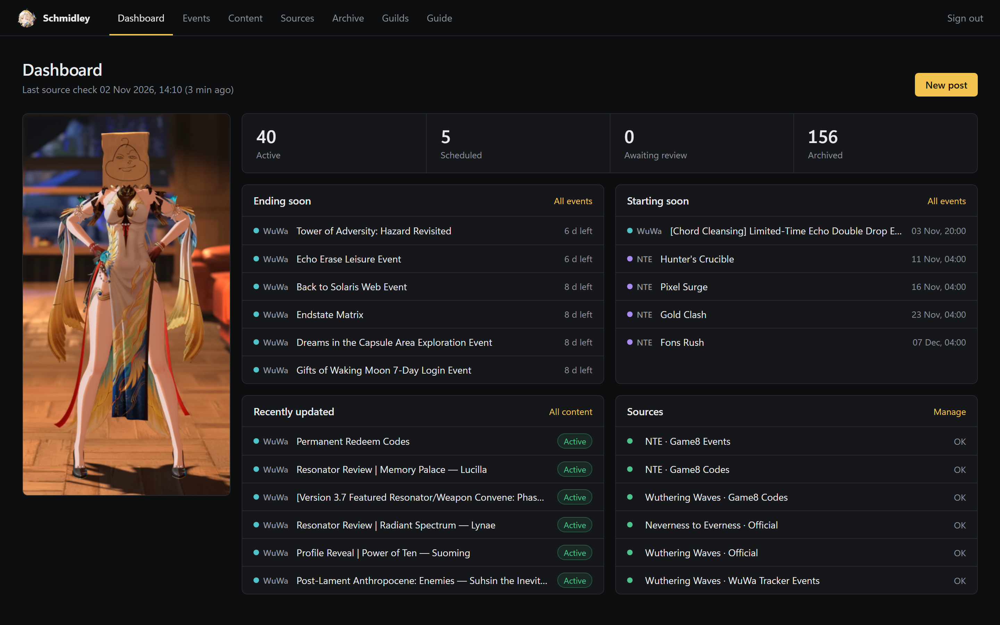
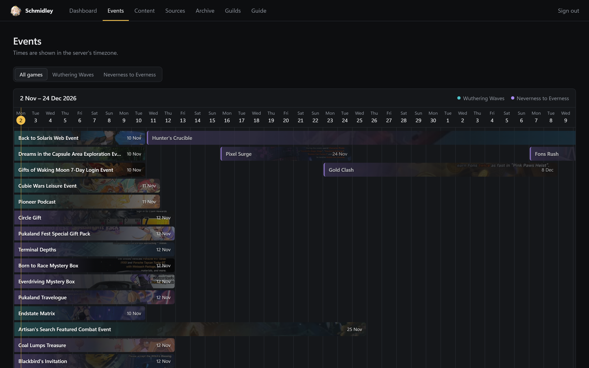
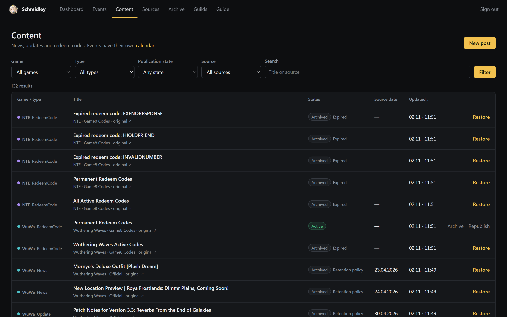
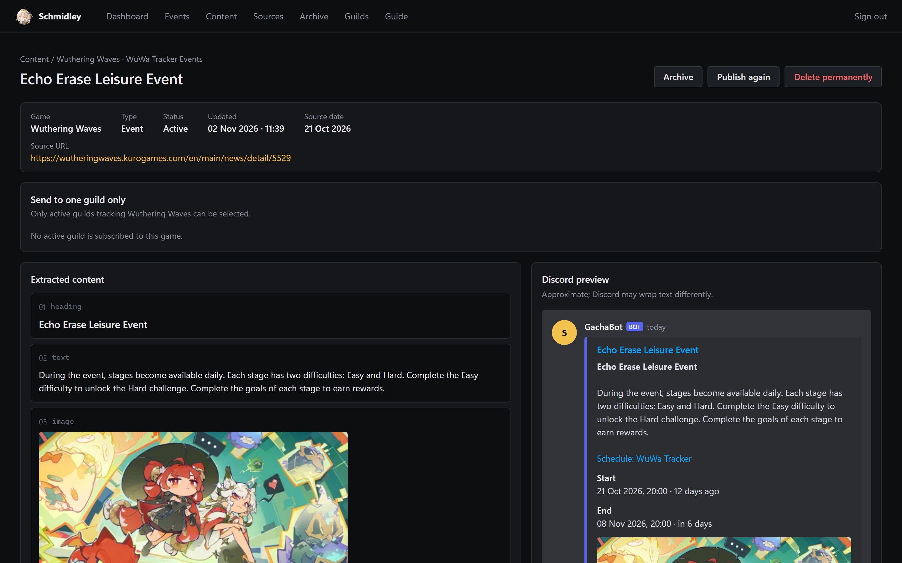
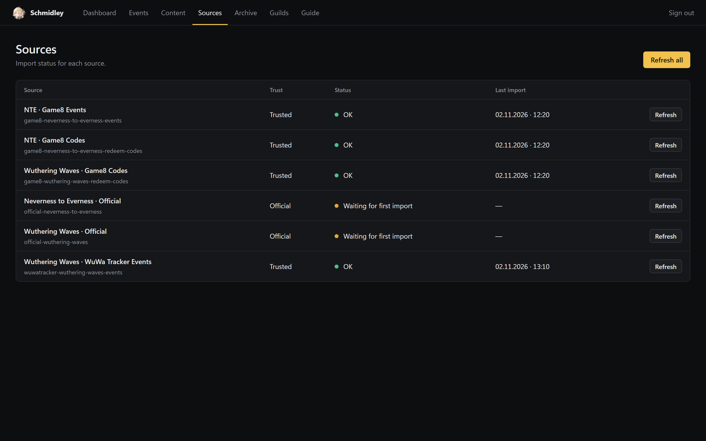

# Dashboard guide

[Back to the documentation index](README.md)

The dashboard is where you check what Gachabot imported, what it will post, and where. Every page reads the same PostgreSQL data the bot publishes from, so what you see is what the queue will send.

## Dashboard

The landing page answers "is everything running?" at a glance:

- **Counts** for active, scheduled, awaiting review and archived content. Each count links to the filtered content list; a non-zero review count is highlighted.
- **Ending soon** lists running events ordered by end time, with the time left.
- **Starting soon** lists announced events that have not started yet.
- **Recently updated** shows the latest changed news, codes and updates.
- **Sources** shows whether the last check of each source succeeded.

The header shows when sources were last checked, as a date and a relative time.

## Events

The calendar starts on the current week's Monday and runs until the last known event ends. Each bar uses the event's artwork; teal marks Wuthering Waves and violet marks Neverness to Everness. Upcoming events are dimmed, and the yellow line marks today. Scroll the calendar sideways with the mouse wheel.

Use the **All games / Wuthering Waves / Neverness to Everness** tabs to filter. Below the calendar, **Active now** is ordered by end time and **Upcoming** by start time. Times are shown in the server's timezone.

## Content

The content list holds news, updates, maintenance notices, character posts and redeem codes. Events have their own calendar and are not listed here.

- Filter by game, type, publication state and source, or search by title and source.
- Click a column header to sort; click again to reverse. Items without a source date stay last in both directions.
- Row actions: **Approve & publish** (items awaiting review), **Archive**, **Republish**, and **Restore** for archived items.

## Content details

The left column shows the content after parsing: headings, text, links, images, galleries, key/value fields and code blocks. The right column renders the exact Discord messages the publisher will send, using the same composer as the bot. Expand **Raw payload** to see the JSON.

From this page you can approve, archive, publish again, delete permanently, or **send to one guild only**. Only active guilds that follow the content's game and subject can be selected.

How content becomes Discord messages:

- The embed title links to the source. Headings, text, links and code go to the description; key/value blocks become fields; images become the main image and follow-up embeds.
- Specific YouTube video links (`youtube.com`, `youtu.be`, `youtube-nocookie.com` iframes) are normalized and sent as plain message content, so Discord can render its own player. This needs the **Embed Links** permission.
- Plain text from a source is not treated as Markdown; characters such as `**` are escaped.
- The composer respects [Discord's message limits](https://docs.discord.com/developers/resources/message#embed-limits). Larger documents are split into several messages, and every message ID is stored, so a later revision can update or remove each part.

## New post

Write a manual announcement: message text, optional link and artwork (HTTPS URL with alt text), game, type and title. Leave the publication time empty to save a draft, or pick a time (Europe/Warsaw) to schedule it. Manual posts go to every active guild that follows the chosen game and subject.

## Sources

The sources table shows each source's trust level, last import time and status. A failed attempt shows its time; hover the status for the error message.

- **Refresh** runs one source now; **Refresh all** runs them in sequence. A summary of seen, new and changed items appears above the table.
- The source name opens its imported content (events open the calendar).

## Archive

Archived items with their type and last change. Each item shows why it was archived:

| Reason | Meaning |
| --- | --- |
| `Expired` | The event or code ended. |
| `Retention` | An official announcement is older than one month. |
| `Superseded` | A newer code list replaced it. |
| `Manual` | An operator archived it. A later refetch can update the document but never restores or republishes it. |

## Guilds

One card per Discord server: destination channel, followed games, event start and ending reminder offsets, and obsolete-post cleanup. **Queue and history** opens the guild's page with:

- **What will be published**: pending posts with their purpose (publication, event start, ending reminder) and due time.
- **Sent and settled publications**: delivered, failed and cancelled posts with attempt counts and errors.

Server settings are changed from Discord with the `gachabot-*` commands, not from the dashboard. See [Configure a guild](../README.md#configure-a-guild).

## Codes

Redeem codes are published as two lists per game: current (time-limited) codes and permanent codes. Codes are rendered as code blocks, which Discord lets players copy, with the expiry date and a live relative time.

When a list changes, Gachabot posts the new list as a new message, so it appears at the bottom of the channel and notifies members. The previous message is deleted only in guilds with `delete-obsolete-posts` enabled. An expired code is kept as an archived record with its rewards.
